# Low-power hardware-efficient memory-based DCT processor

[](https://github.com/VKHS/memory-based-dct8/actions/workflows/ci.yml)
[](https://doi.org/10.1007/s11554-022-01243-x)
[](LICENSE)

Reference implementation of the processor published in

> AbdolVahab Khalili Sadaghiani and Behjat Forouzandeh,
> **"Low-power hardware-efficient memory-based DCT processor,"**
> *Journal of Real-Time Image Processing*, vol. 19, pp. 1105–1121, 2022.
> [doi:10.1007/s11554-022-01243-x](https://doi.org/10.1007/s11554-022-01243-x)

The 8-point DCT is computed with the scalable radix-2 algorithm on two processing
elements, a **butterfly unit** and a shared **central CORDIC unit**, around a small
partitioned memory bank. There is no multiplier: every constant is a shift-add
micro-rotation. The repository contains bit-exact models and implementations in
**Python, Verilog RTL, Vitis HLS C++ and MATLAB/Octave**, an **8×8 2-D processor**,
the **16-point extension**, golden test vectors, figures and a smoke test.

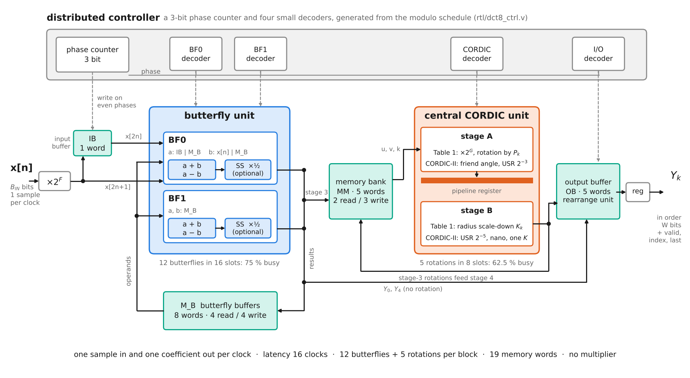

| | |
|---|---|
| throughput | one sample in and one coefficient out per clock, both in natural order |
| latency | 16 clocks (1-D), 97 clocks (8×8 2-D) |
| work per 8-point block | 12 butterflies + 5 rotations, no multiplication |
| storage | 19 words: input buffer 1, butterfly buffers M_B 8, memory bank 5, output buffer 5 |
| control | a 3-bit phase counter and four small decoders (generated from the schedule) |
| micro-rotations | the paper's Table 1 (10+j2, 50+j21, 50+j33) or an extended CORDIC-II unit |
| word length | any W ≥ 8 for 8-bit inputs, overflow-free for every input |
| verification | Python, RTL (two adder styles), HLS and MATLAB agree bit for bit on 9 vector sets |

**Contents** · [Quick start](#quick-start) · [Algorithm](#algorithm) ·
[Architecture](#architecture) · [Schedule](#schedule-and-memory) ·
[Fixed point](#fixed-point-design) · [CORDIC unit](#central-cordic-unit) ·
[Results](#results) · [2-D](#8x8-2-d-processor) · [16-point](#16-point-extension) ·
[Verification](#verification) · [Implementations](#implementations) ·
[Layout](#repository-layout) · [Citation](#citation)

---

## Quick start

```bash
git clone https://github.com/VKHS/memory-based-dct8.git
cd memory-based-dct8
pip install -e "python[test]"
./scripts/smoke_test.sh      # Python tests + HLS C simulation + RTL + MATLAB, whatever is installed
```

| command | what it runs |
|---|---|
| `make python` | 94 pytest cases: rounding, flow graph, both CORDIC modes, overflow proof, schedule invariants, cycle models, generated files up to date |
| `make hls` | C simulation of the HLS kernels against all 9 vector sets (g++) |
| `make rtl` | Icarus Verilog simulation of all 9 vector sets, both adder styles |
| `make matlab` | the MATLAB/Octave model against the same vectors |
| `make figures` / `make report` | regenerate `figures/` and [`docs/results.md`](docs/results.md) |

```python
from dct8 import Config, dct8_fixed, dct8_approx

cfg = Config(b_in=8, w=14, guard=3, ss=(0, 0, 0), mr_mode="table1")
x = [12, -7, 100, 3, -128, 127, 0, 45]
dct8_fixed(x, cfg)    # [1216, -321, 905, -829, -2304, 1031, 3228, -1737]  -- the RTL output words
dct8_approx(x, cfg)   # [53.74, -14.19, 40.00, -36.64, -101.82, 45.56, 142.66, -76.77]
                      #  orthonormal DCT-II:  53.74, -13.82, 39.30, -36.19, -101.82, 46.09, 142.92, -76.74
```

---

## Algorithm

The N-point DCT-II splits into two N/2-point DCTs and N/2 − 1 plane rotations
(paper, Eqs. 4–13). With *M* = *N*/2:

```
x_L[m] = x[2m] + x[2m+1]          x_H[m] = x[2m] - x[2m+1]          m = 0 .. M-1
A = DCT_M( x_L )                  B = DCT_M( (-1)^m x_H )
Z[0] = A[0]                       Z[M] = B[0]
( Z[k], Z[N-k] ) = Rot(-k·π/(2N)) · ( A[k], B[M-k] )                 k = 1 .. M-1
```

The adjacent-pair butterflies need no reordering of the input, and with unscaled
butterflies every output carries the same factor √N (`Z = √N · X`, orthonormal
*X*), so a single post-scaling constant remains. Applied recursively for
8 → 4 → 2 this gives **three butterfly stages and two rotation stages**:
12 butterflies and 5 rotations that use only three angles, π/16, π/8 and 3π/16.
For N = 8 the outputs are `Y_k = 2√2 · X_k`, the paper's post-scaling factor 1/(2√2).

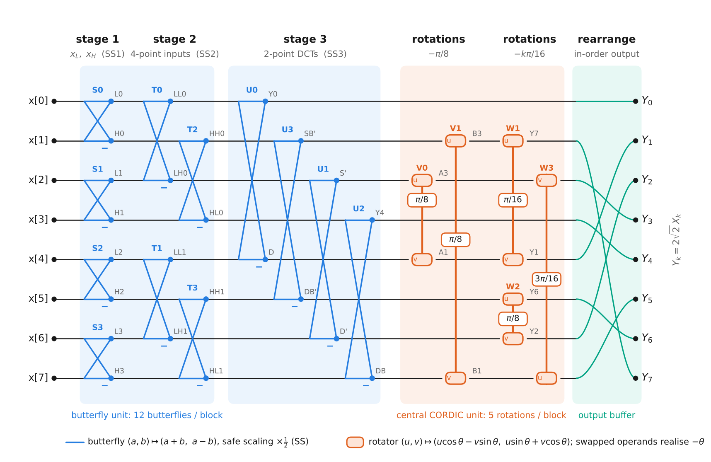

The graph is drawn in place: every operation writes its results onto the rows of
its operands, and a final rearrangement restores natural order — which is exactly
the job of the output buffer. Every intermediate value has one consumer, which is
why a small memory suffices. The graph shows all three butterfly levels; the compact
drawing in Fig. 2(c) of the paper omits the third (2-point) level, without which
`C(0)` would equal `x0 + x1 + x2 + x3`. A rotation by −θ is obtained from the
counter-clockwise rotator by swapping both operands and results, i.e. by addressing:
`Rot(−θ)(u, v) = swap(Rot(θ)(v, u))`. The flow graph equals `2√2 · C8` to 10⁻¹³
(`python/tests/test_flowgraph.py`), and the recursion is checked for N = 2 … 64.

## Architecture

Two processing elements share one partitioned memory (figure above):

* **Butterfly unit** — two butterfly datapaths BF0 and BF1, each `a ± b` on
  W + 1 bits followed by a **safe-scaling (SS) unit** that halves the result when
  the stage is configured to (SS1, SS2, SS3). BF0 receives the incoming sample
  directly: `x[2n]` waits one clock in the input buffer and the stage-1 butterfly
  fires in the clock in which `x[2n+1]` arrives (the one-delay feedback of the
  paper's first stage). 12 butterflies in 16 slots: 75 % busy.
* **Central CORDIC unit** — one rotation unit executes all five rotations; its
  stages are shared by the three angles and only the stage options change with the
  angle code *k*. Two pipeline stages. 5 rotations in 8 slots: 62.5 % busy.
* **Memory, partitioned by reader** — butterfly buffers M_B (8 words, read by
  the butterfly unit), the memory bank (5 words, the operands of the CORDIC unit,
  written by the butterfly unit and by the CORDIC unit itself) and the output
  buffer (5 words, the rearrange unit that turns out-of-order results into in-order
  coefficients). Register files with read-before-write semantics.
* **Distributed controller** — a 3-bit phase counter and four decoders (BF0, BF1,
  CORDIC, I/O). Each value lives at most 8 clocks, so every address is a function
  of the phase only; the decoders are emitted from the schedule into
  [`rtl/dct8_ctrl.v`](rtl/dct8_ctrl.v) and [`hls/src/dct8_sched.h`](hls/src/dct8_sched.h).

### Schedule and memory

An exact branch-and-bound modulo scheduler (`python/dct8/schedule.py`) places the
17 operations for a new block every 8 clocks, minimising the output latency, then
the number of memory words, then the total storage time; the registers of each bank
are allocated by an exact circular-arc colouring.

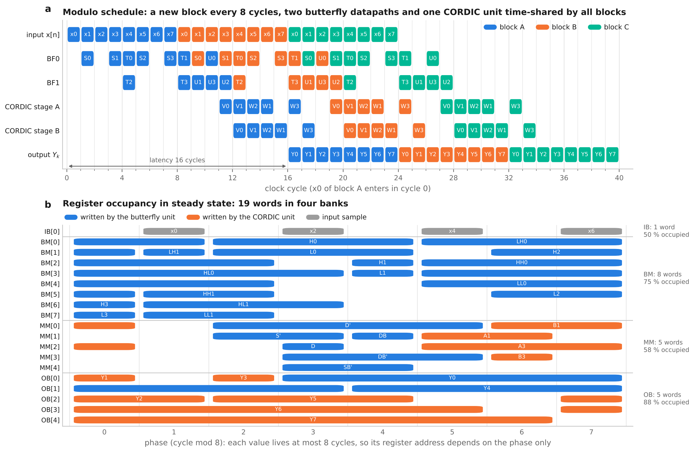

The resulting microcode (bank[register]; `x[n]` is the input bypass):

| phase | BF0 | BF1 | CORDIC issue | CORDIC write-back | output |
|---|---|---|---|---|---|
| 0 | T1: BM[5], BM[7] → BM[7], BM[1] | T3: BM[1], BM[6] → BM[5], BM[6] | W3 (3π/16): MM[0], MM[2] | – | Y1 ← OB[0] |
| 1 | S0: IB, x[n] → BM[1], BM[0] | U1: BM[0], BM[1] → MM[1], MM[0] | – | W3 → OB[2], OB[0] | Y2 ← OB[2] |
| 2 | U0: BM[4], BM[7] → OB[0], MM[2] | U3: BM[2], BM[5] → MM[4], MM[3] | – | – | Y3 ← OB[0] |
| 3 | S1: IB, x[n] → BM[3], BM[2] | U2: BM[3], BM[6] → OB[1], MM[1] | V0 (π/8): MM[1], MM[2] | – | Y4 ← OB[1] |
| 4 | T0: BM[1], BM[3] → BM[4], BM[0] | T2: BM[0], BM[2] → BM[2], BM[3] | V1 (π/8): MM[4], MM[1] | V0 → MM[2], MM[1] | Y5 ← OB[2] |
| 5 | S2: IB, x[n] → BM[5], BM[1] | – | W2 (π/8): MM[3], MM[0] | V1 → MM[3], MM[0] | Y6 ← OB[3] |
| 6 | – | – | W1 (π/16): MM[3], MM[1] | W2 → OB[3], OB[2] | Y7 ← OB[4] |
| 7 | S3: IB, x[n] → BM[7], BM[6] | – | – | W1 → OB[4], OB[0] | Y0 ← OB[0] |

The input buffer is written in the even phases. Peak port use: M_B 4 read / 4 write,
memory bank 2 read / 3 write, output buffer 1 read / 2 write.

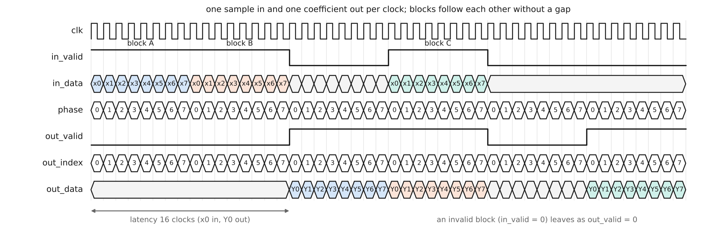

`in_valid` is sampled with `x0` and travels with its block, so invalid blocks may be
inserted anywhere; `ce` stalls the whole processor.

## Fixed-point design

| parameter | meaning |
|---|---|
| `B_IN` | input word length (signed) |
| `W` | internal word length (WL) of memory, butterflies and CORDIC ports |
| `G` | guard bits of the CORDIC unit (radius scale-up) |
| `SS1, SS2, SS3` | safe scaling ×½ after butterfly stage 1, 2, 3 |
| `MR_MODE` | 0: Table 1 micro-rotations, 1: CORDIC-II extension |

The input is aligned as `x · 2^F` with `F = W − B_IN − H` fractional bits and
`H = 3 − SS1 − SS2 − SS3` headroom bits; every output word is
`Y_k = 2√2 · X_k · 2^E` with `E = F − ΣSS`. Three headroom bits are exactly what the
flow graph needs: the largest node is the DC sum (8 · max|x|), every rotation node
stays below 7.39 · max|x| (panel a). The DC of a full-scale negative input lands
exactly on −2^(W−1).

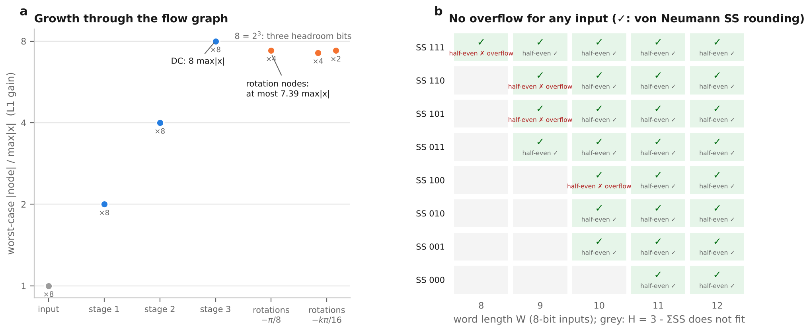

The SS units use **von Neumann rounding** (round half to odd): `(z >>> 1) | z[0]`, the
discarded bit OR-ed into the LSB. It costs no adder, is unbiased, and can never round
`2^(W−1) − ½` up to `2^(W−1)`. With round-half-to-even, four configurations with no
fractional input bit (F = 0) exceed the range by one LSB at extreme inputs and wrap
around (panel b). With the
von Neumann SS units, all 120 configurations — W = 8 … 16, every valid safe-scaling
choice, both CORDIC modes — have no overflow in any flow-graph node or CORDIC register
(`python/tests/test_processor.py::test_no_overflow_anywhere`). The CORDIC unit rounds
half to even.

## Central CORDIC unit

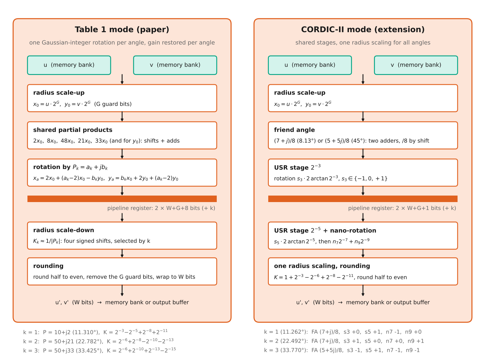

**Table 1 mode (the paper).** Each angle is a Gaussian integer `P_k = a_k + j b_k`:
radius scale-up by G guard bits, an exact shift-add rotation by `P_k` built from shared
partial products (2x, 8x, 48x, 21x, 33x), and a radius scale-down `K_k ≈ 1/|P_k|` of four
signed powers of two whose shifts are selected by *k* before rounding.

**CORDIC-II mode (extension).** Friend angle (7+j)/8 or (5+5j)/8, uniformly-scaled
redundant stages 2⁻³ and 2⁻⁵, a nano-rotation (2⁻⁷, 2⁻⁹) and one radius scaling
`K = 1 + 2⁻³ − 2⁻⁶ + 2⁻⁸ − 2⁻¹¹` common to all angles.

| mode | k | target | realised | angle error (rad) | gain |
|---|---|---|---|---|---|
| Table 1 | 1 | 11.2500° | 11.3099° (10+j2) | +1.05·10⁻³ | 1.000882 |
| Table 1 | 2 | 22.5000° | 22.7824° (50+j21) | +4.93·10⁻³ | 0.999619 |
| Table 1 | 3 | 33.7500° | 33.4248° (50+j33) | −5.68·10⁻³ | 1.000056 |
| CORDIC-II | 1 | 11.2500° | 11.2623° | +2.15·10⁻⁴ | 0.999954 |
| CORDIC-II | 2 | 22.5000° | 22.4920° | −1.39·10⁻⁴ | 0.999925 |
| CORDIC-II | 3 | 33.7500° | 33.7703° | +3.54·10⁻⁴ | 0.999971 |

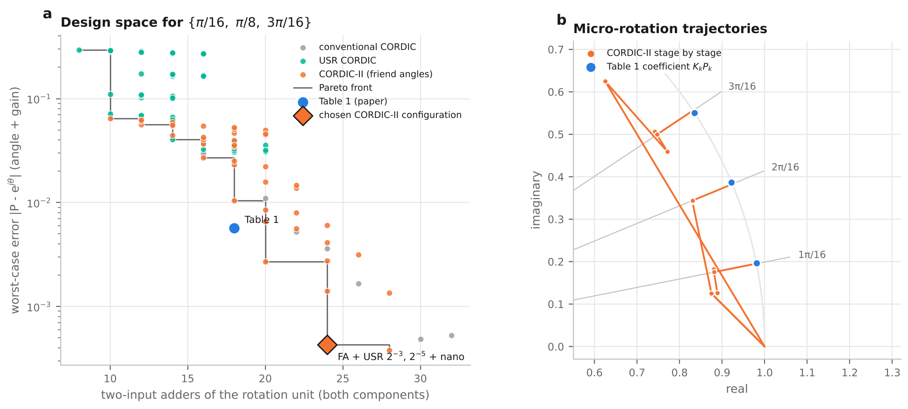

Panel (a) places both units in the design space of conventional, USR and CORDIC-II
rotators for {π/16, π/8, 3π/16} (`cordic2.explore()`). The Table 1 rotator reaches
a 5.7·10⁻³ worst-case error with 18 adders, about half the error of the best
CORDIC-family rotator with the same adder count; the CORDIC-II configuration lowers the
worst-case error 13× (the angle error 16×) with 24 adders.

## Results

All numbers below are measured on the bit-accurate model, which the RTL, HLS and
MATLAB implementations reproduce bit for bit. Full tables: [`docs/results.md`](docs/results.md).

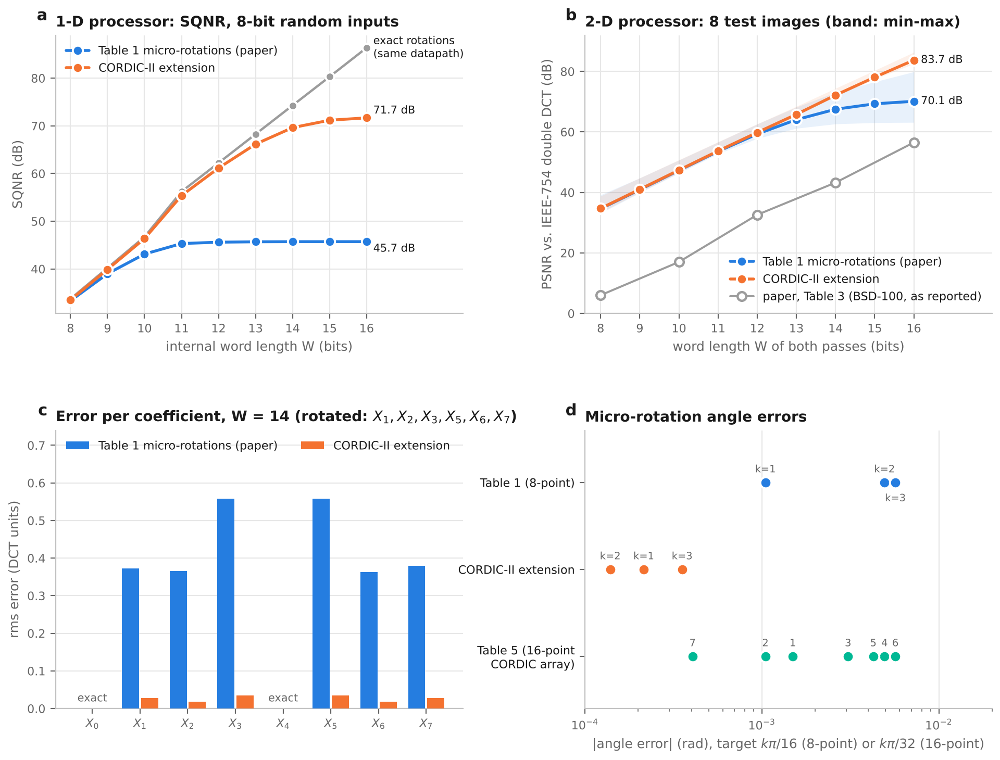

* **(a) 1-D, random 8-bit inputs.** With Table 1 micro-rotations the SQNR saturates at
  45.7 dB from W = 11 on: the angle errors of the three Gaussian integers dominate
  (panel c: rotated outputs only). The CORDIC-II unit stays within about 1 dB of the
  exact-rotation datapath up to W = 12 and reaches 71.7 dB.
* **(b) 2-D, eight test images.** PSNR of the processor's 2-D DCT against the
  IEEE-754 double-precision DCT (peak 255), both passes at word length W:

  | W | 8 | 10 | 12 | 14 | 16 |
  |---|---|---|---|---|---|
  | Table 1 micro-rotations | 34.6 dB | 47.3 dB | 59.3 dB | 67.5 dB | 70.1 dB |
  | CORDIC-II extension | 34.7 dB | 47.4 dB | 59.8 dB | 72.2 dB | 83.7 dB |
  | paper, Table 3 (BSD-100 images, as reported) | 6.02 dB | 17.01 dB | 32.60 dB | 43.24 dB | 56.51 dB |

  The test images differ (scikit-image samples here, BSD-100 in the paper); at short
  word lengths the difference comes from the overflow-free scaling with von Neumann
  SS rounding of this implementation.

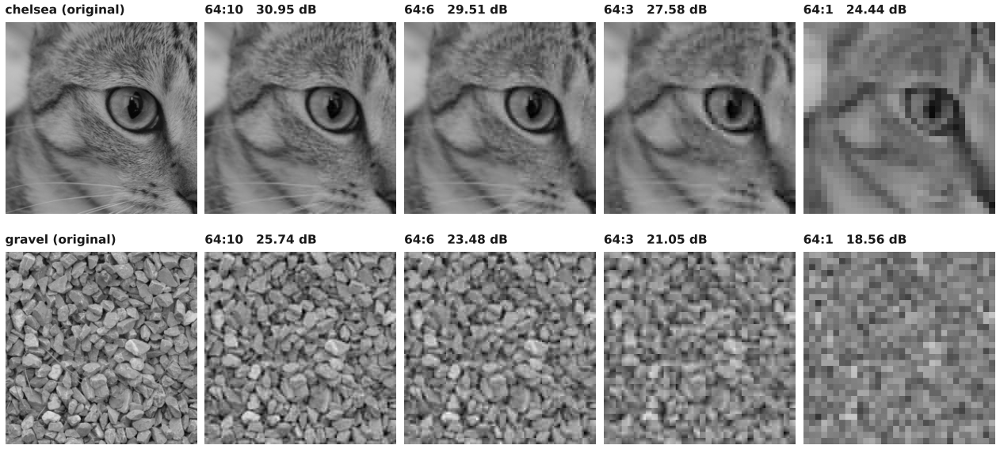

Zonal compression as in the paper (keep the first 10, 6, 3 or 1 zig-zag coefficients of
every 8×8 block) through the bit-accurate 2-D processor (W 14/16, Table 1): for all
eight test images and all four ratios the PSNR is within 0.002 dB of the
double-precision DCT.

**Hardware cost.** Architecture-level counts from the RTL structure (not synthesis):

| configuration | adders (two-input) | rounding increments | register bits | memory words | multipliers |
|---|---|---|---|---|---|
| W = 14, G = 3, Table 1 | 22 (4 butterfly + 18 CORDIC) | 10 | 343 | 19 | 0 |
| W = 14, G = 3, CORDIC-II | 28 (4 butterfly + 24 CORDIC) | 24 | 329 | 19 | 0 |

The paper reports for its implementation on an Artix-7 XC7A25T (Vivado 2018, WL 14):
0 DSP blocks, 352 LUTs, 440 FFs, 144 Msps and 91 mW (Table 2), and 25 additions,
1 CORDIC unit, 6 M_B, 29 shifts and 22 multiplexers (Table 4).
[`scripts/vivado_synth.tcl`](scripts/vivado_synth.tcl) and [`hls/run_hls.tcl`](hls/run_hls.tcl)
implement this repository's RTL and HLS kernels on the same device.

## 8×8 2-D processor

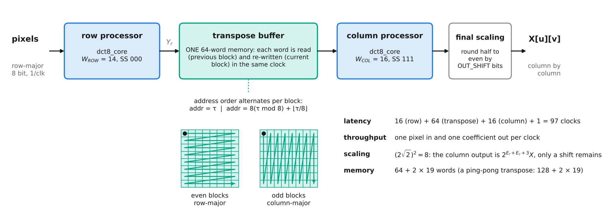

Row processor → transpose buffer → column processor → final scaling. The transpose
buffer is a **single 64-word memory**: in every clock one word is read (previous block,
transposed order) and re-written (current block), and the address order alternates
between row-major and column-major from block to block, so no ping-pong buffer is
needed. The two post-scaling factors combine to (2√2)² = 8, so the column output is
`2^(E_row + E_col + 3) · X` and the last stage only shifts — rounding half to even, or an
exact left shift at very short word lengths. Coefficients leave column by column
(`out_u = u`, `out_v = v`).

## 16-point extension

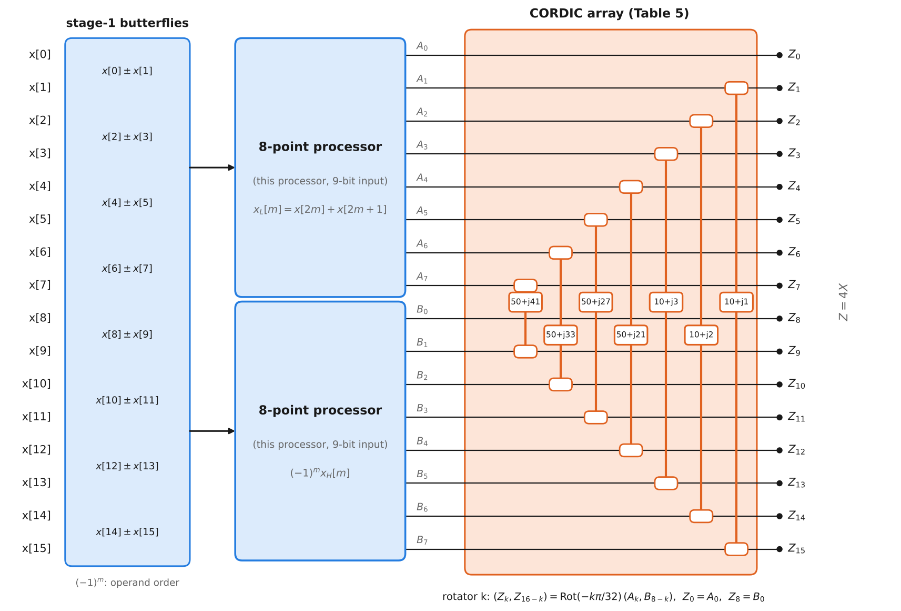

One more radix-2 step: 8 stage-1 butterflies, the two 8-point processors (one for
`x_L`, one for `(−1)^m x_H`, the sign being free through the operand order) and a
CORDIC array of seven rotators with the Gaussian integers of the paper's Table 5
(10+j, 10+j2, 10+j3, 50+j21, 50+j27, 50+j33, 50+j41; k = 2, 4, 6 are the Table 1
entries). Laid out in place, the array delivers the 16 outputs in natural order with
the uniform scale `Z = 4 · X`. Bit-accurate model: `dct8.scalable.dct16_fixed`
(Python) and `dct16_fixed.m` (MATLAB); rms error 0.25 with W = 15 CORDIC-II engines.

## Verification

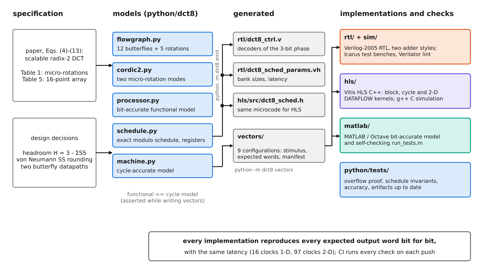

`python/dct8` holds the functional model (`processor.py`) and a cycle-accurate model
(`machine.py`) that runs the same microcode as the RTL; the two are compared while the
vectors are written. Nine vector sets in [`vectors/`](vectors/) exercise
all-extreme corner inputs, impulses, Nyquist patterns, image rows, random data and
invalid gap blocks:

| vector set | processor | W | SS | micro-rotations | notes |
|---|---|---|---|---|---|
| `dct8_t1_w14` | 1-D | 14 | 000 | Table 1 | default configuration |
| `dct8_c2_w14` | 1-D | 14 | 000 | CORDIC-II | |
| `dct8_t1_w10ss` | 1-D | 10 | 111 | Table 1 | |
| `dct8_c2_w12ss` | 1-D | 12 | 010 | CORDIC-II | G = 2 |
| `dct8_t1_w8ss` | 1-D | 8 | 111 | Table 1 | no fractional bit (F = 0) |
| `dct2d_t1` | 2-D | 14 / 16 | 000 / 111 | Table 1 | integer output |
| `dct2d_c2` | 2-D | 14 / 16 | 000 / 111 | CORDIC-II | integer output |
| `dct2d_c2_f2` | 2-D | 14 / 16 | 000 / 111 | CORDIC-II | two fractional output bits |
| `dct2d_t1_w10` | 2-D | 10 / 10 | 111 / 111 | Table 1 | final stage is a left shift |

Every implementation reproduces every expected word: the RTL with both adder styles
(behavioural `+`, and carry-save compression with a Kogge-Stone adder), the HLS block,
cycle and 2-D kernels, and the MATLAB model. The RTL and HLS test benches also check
the latency (16 / 97 clocks), the coefficient index and the `last` flag.
CI ([`.github/workflows/ci.yml`](.github/workflows/ci.yml)) runs pytest, Verilator lint,
Icarus simulation, the HLS C simulation with both the stand-in and the official
`ap_int` headers, and Octave on every push.

## Implementations

### Python — `python/dct8`

| module | content |
|---|---|
| `fixedpoint` | `rnd` (half up), `rne` (half even), `rno` (half odd), `wrap`; work on ints and NumPy arrays |
| `flowgraph` | the 17 operations of the radix-2 flow graph |
| `cordic2` | both micro-rotation modes, stage by stage; design-space exploration |
| `processor` | `Config`, `dct8_fixed`, `dct8_fixed_batch`, `dct8_approx` |
| `schedule`, `machine`, `emit` | modulo schedule and register allocation; cycle-accurate model; RTL/HLS generators |
| `dct2d`, `scalable` | 2-D processor (functional + cycle-accurate); N-point recursion and the 16-point processor |
| `analysis`, `cost`, `vectors` | overflow proof, word-length and image experiments; cost; golden vectors |

`python -m dct8 info | emit | vectors | schedule` prints the CORDIC tables, the schedule
and the cost, or regenerates the generated files.

### Verilog RTL — `rtl/`

| file | module(s) |
|---|---|
| `dct8_core.v` | the 1-D processor |
| `cordic2_mr.v` | central CORDIC unit, both modes (`MR_MODE`) |
| `dct8_bf_pe.v` | butterfly datapath with its SS unit |
| `dct8_mem_bank.v` | multi-port register-file bank (M_B, memory bank, output buffer) |
| `dct8_ctrl.v`, `dct8_sched_params.vh` | generated decoders and schedule constants |
| `dct8_adders.v`, `dct8_round.v` | 3:2 / 4:2 compressors, Kogge-Stone adder, multi-operand adders; rounding shifts |
| `dct2d_8x8.v`, `dct8_transpose.v` | 2-D processor and its single-buffer transpose memory |

`dct8_core` parameters: `B_IN, W, G, SS1, SS2, SS3, MR_MODE, STYLE`; ports `clk, rst, ce,
in_valid, in_data[B_IN] → out_valid, out_index[3], out_last, out_data[W]`. Plain
Verilog-2005, synchronous active-high reset, no vendor primitives.

### Vitis HLS — `hls/`

`hls/src/dct8_hls.h` provides three kernels with one arithmetic core (`dct8_arith.h`):
`dct8_block_top` (the flow graph with `ALLOCATION` of two butterfly datapaths and one
CORDIC unit, `II = 8`), `dct8_cycle_top` (the RTL micro-architecture driven by the
generated microcode, `II = 1`, cycle-exact with the RTL) and `dct2d_top` (row pass,
single-buffer transpose and column pass as a `DATAFLOW` region). The configuration is
set by macros (`DCT_W`, `DCT_MR_MODE`, …). `scripts/run_hls_csim.py` compiles the C
simulation for every vector set with g++; `hls/csim_compat/` holds minimal `ap_int.h` /
`hls_stream.h` stand-ins for that purpose (Vitis HLS uses its own headers).
`vitis_hls -f hls/run_hls.tcl [-tclargs <top> <part> <period>]` runs C simulation,
synthesis and IP export.

### MATLAB / Octave — `matlab/`

`dct8_cfg`, `dct8_fixed` (vectorised over rows), `dct8_cordic`, `dct2d_fixed`,
`dct16_fixed` and the rounding primitives, bit-exact with the other implementations;
`run_tests` checks them against `vectors/`, `demo_dct8` prints the micro-rotation and
word-length tables and shows zonal compression of an image.

## Repository layout

```
├── python/dct8/        bit-accurate and cycle-accurate models, schedule, generators, analysis
├── python/tests/       pytest suite
├── rtl/                Verilog-2005 RTL (1-D and 2-D processors)
├── sim/                self-checking test benches (Icarus Verilog)
├── hls/                Vitis HLS kernels, C test benches, run_hls.tcl, csim stand-in headers
├── matlab/             MATLAB / Octave model, run_tests, demo
├── vectors/            golden vectors (9 configurations) and manifest.json
├── figures/            all figures (scripts/make_figures.py)
├── docs/results.md     measured results (scripts/report.py)
├── scripts/            smoke test, RTL and HLS runners, figures, report, Vivado synthesis
└── .github/workflows/  CI
```

## Citation

```bibtex
@article{KhaliliSadaghiani2022DCT,
  author  = {Khalili Sadaghiani, AbdolVahab and Forouzandeh, Behjat},
  title   = {Low-power hardware-efficient memory-based {DCT} processor},
  journal = {Journal of Real-Time Image Processing},
  volume  = {19},
  pages   = {1105--1121},
  year    = {2022},
  doi     = {10.1007/s11554-022-01243-x}
}
```

Code and figures: MIT license ([LICENSE](LICENSE)).
